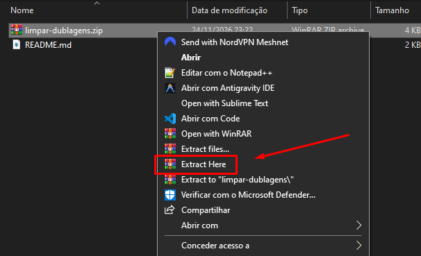
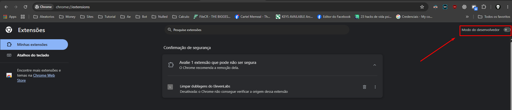
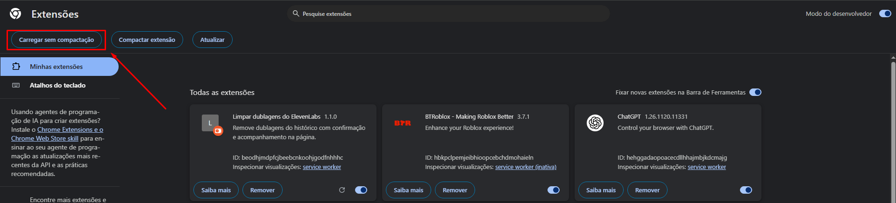
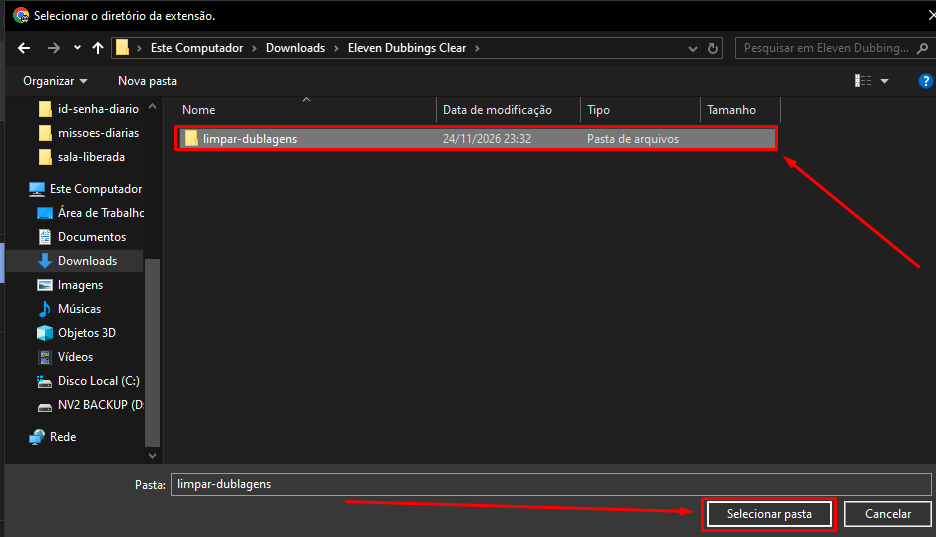
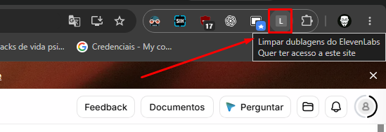
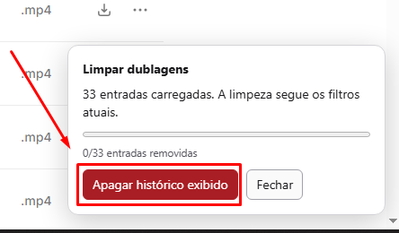
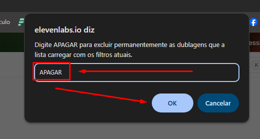

# Eleven Dubbings Clear

Extensão independente para Google Chrome que limpa o histórico de Dublagem do ElevenLabs. A barra de progresso mostra quantas entradas foram removidas e atualiza o total quando a página carrega mais itens.

## Instalação no Chrome

### 1. Extrair o ZIP

Extraia todos os arquivos do ZIP. No Windows, clique com o botão direito no ZIP e selecione **Extrair tudo…**.

### 2. Ativar o modo do desenvolvedor

Abra `chrome://extensions` na barra de endereços e ative **Modo do desenvolvedor**.

### 3. Carregar a extensão

Clique em **Carregar sem compactação**.

### 4. Selecionar a pasta

Selecione a pasta extraída que contém o arquivo `manifest.json` e clique em **Selecionar pasta**.

## Como usar

### 1. Abrir o painel

Entre no ElevenLabs, abra **Dublagem** e clique em **Eleven Dubbings Clear** no menu de extensões do Chrome.

### 2. Iniciar a limpeza

No painel da extensão, clique em **Apagar histórico exibido**. Para incluir todo o histórico disponível na lista, limpe a pesquisa e os filtros antes de começar.

### 3. Confirmar a exclusão

Digite `APAGAR` e confirme. A exclusão é permanente.

Acompanhe a barra de progresso. Use **Parar** para interromper a fila. Uma remoção já enviada pode ser concluída. Ao terminar, recarregue a aba e confira se restaram entradas.

## Como funciona

A extensão usa as permissões `activeTab` e `scripting` para abrir o painel na aba ativa. Ela usa os controles da página na sessão aberta, sem chave de API. O projeto é independente e não é afiliado ao ElevenLabs.
